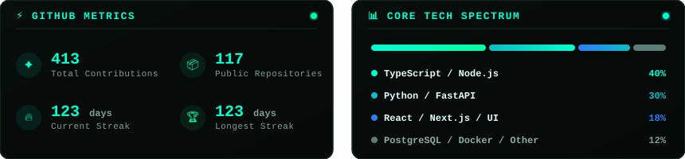

 

<table align="center">
  <tr>
    <td></td>
    <td></td>
  </tr>
</table>

  

<h3><code>Contributions</code></h3>
 

  

<h3><code>Featured Projects</code></h3>

 

<table align="center">
<tr>
<td width="50%" valign="top">

###  Do.Quests

> A quest management app focused on small tasks for task creators and task submitters, making task completion and rewards easier and smoother.

**Tech:** `Next.js` · `shadcn/ui` · `TypeScript` · `NestJS` · `MongoDB` · `@nestjs/mongo` · `class-validator` · `Stripe`

[`Frontend`](https://github.com/furqanRupom/do-quest-frontend) · [`Backend`](https://github.com/furqanRupom/do-quest-backend)

</td>
<td width="50%" valign="top">

###  Content Forge AI

> An application built for content creators who want to create content easily and affordably.

**Tech:** `Next.js` · `shadcn/ui` · `TypeScript` · `Express.js` · `PostgreSQL` · `Prisma ORM` · `better-auth`

[`Frontend`](https://github.com/furqanRupom/content-forge-frontend) · [`Backend`](https://github.com/furqanRupom/content-forge-backend)

</td>
</tr>
<tr>

</tr>
</table>

  

<h3><code>Tech Arsenal</code></h3>

 

**`Backend`**

  

**`Frontend`**

  

**`Database`**

  

**`ORM / Data`**

  

**`DevOps / Tools`**

  

  

<h3><code>GitHub Stats &amp; Activity</code></h3>
 

  

  

  

